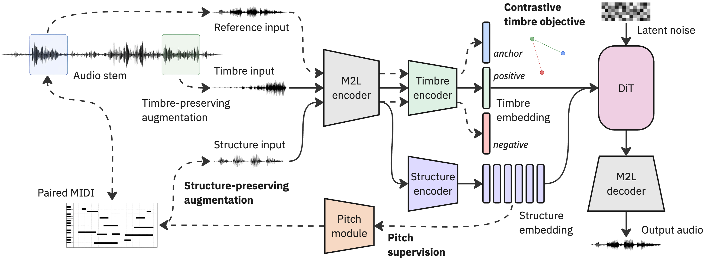

# Symbolic-Guided Disentanglement for One-Shot Timbre Transfer and Controllable Music Generation

*Anonymous authors. Paper currently under review.*

## Overview

This repository implements a symbolic-guided framework that explicitly incorporates MIDI information to guide structure--timbre disentanglement, enabling one-shot timbre transfer and controllable music generation.

The method operates in the latent space of the frozen Music2Latent (M2L) music autoencoder. Lightweight encoders extract a temporal structure representation and a global timbre representation. A diffusion transformer (DiT), trained under a rectified-flow objective, generates M2L latents from these conditions.

During training, the method combines:

- structure-preserving augmentations, produced by re-synthesizing aligned MIDI with different instrument programs;
- pitch supervision of the temporal structure representation; and
- a contrastive timbre objective using timbre-preserving and structure-preserving augmentations.

Symbolic information is used during training only; it is not required for reconstruction or one-shot timbre transfer at inference time.



Solid arrows denote components used during training and inference; dashed arrows denote training-only components.

## Installation

The supported environment is Python 3.11. The requirements select CUDA-enabled PyTorch wheels; use a compatible NVIDIA driver and replace the PyTorch index in `requirements.txt` if a CPU-only or different CUDA environment is required.

```bash
python3.11 -m venv venv
source venv/bin/activate
python -m pip install --upgrade pip
python -m pip install -r requirements.txt
python -m pip install -e .
```

Music2Latent downloads its pretrained checkpoint on first use. Basic Pitch, dataset preparation, and training use this same environment.

### MIDI re-synthesis for structure-preserving augmentations

The main symbolic-guided configuration uses structure-preserving augmentations, which require the included `midi2audio` synthesizer and a General MIDI soundfont. Build the synthesizer once:

```bash
cargo build --release --manifest-path midi2audio/Cargo.toml
```

The soundfont is not distributed with this repository. Pass its location with `--struct_aug_soundfont` when preparing a dataset. This step is unnecessary only for configurations that disable structure-preserving augmentations.

## Prepare a dataset

`scripts.prepare_dataset` converts audio, symbolic labels, and augmentation banks into an LMDB dataset. The released configurations use 44.1 kHz, 10-second chunks and M2L latents.

The supported parsers are `slakh` (default), `urmp`, `maestro`, and `guitarset`. Parsers use supplied, aligned annotations when available. Basic Pitch is the default fallback for a corpus without MIDI; use `--save_auto_transcription` to additionally store automatic-transcription targets alongside supplied reference MIDI.

Prepare a dataset for the main synthetic-data configuration:

```bash
python -m scripts.prepare_dataset \
  --input_dir /path/to/slakh2100_flac_redux \
  --output_dir ./experiments/datasets/slakh2100_midi_aug \
  --dataset_parser slakh \
  --emb_model music2latent \
  --latents_only \
  --save_midi \
  --save_struct_aug_latent \
  --struct_aug_synth_binary ./midi2audio/target/release/midi2audio \
  --struct_aug_soundfont /path/to/TimGM6mb.sf2 \
  --save_timbre_aug_latent
```

To add Basic Pitch targets as an automatic-transcription variant, add:

```bash
--save_auto_transcription
```

This writes `midi_roll_basic_pitch` and `z_struct_aug_basic_pitch` in addition to the reference `midi_roll` and `z_struct_aug` arrays. Use `--transcription_backend none` to disable automatic MIDI fallback entirely.

Run `python -m scripts.prepare_dataset --help` for preprocessing, parser, augmentation, and CLAP-feature options.

## Train a model

`scripts.train` trains from one prepared LMDB dataset or a named collection of datasets. The command below uses the main synthetic-data configuration:

```bash
python -m scripts.train \
  --dataset_path ./experiments/datasets/slakh2100_midi_aug \
  --config base.gin \
  --name baseline \
  --output_dir ./experiments/runs \
  --batch_size 128 \
  --learning_rate 1e-4 \
  --epochs 300
```

For joint real-world training, prepare each corpus independently and use `combined.gin`:

```bash
python -m scripts.train \
  --dataset_paths "urmp=./experiments/datasets/urmp,maestro=./experiments/datasets/maestro,guitarset=./experiments/datasets/guitarset" \
  --config combined.gin \
  --name combined \
  --output_dir ./experiments/runs \
  --batch_size 128 \
  --learning_rate 1e-4 \
  --epochs 300
```

Pass `--no_wandb` to disable Weights & Biases logging. Run `python -m scripts.train --help` for all options.

### Released configurations

| Configuration | Purpose |
| --- | --- |
| `base.gin` | Main synthetic-data configuration. |
| `base_no_pitch.gin` | Removes pitch supervision. |
| `base_no_struct_aug.gin` | Removes structure-preserving augmentations. |
| `base_no_triplet.gin` | Removes the contrastive timbre objective. |
| `base_clap_timbre.gin` | Uses frozen music-CLAP timbre features. |
| `base_m2l_struct.gin` | Uses M2L latents directly as temporal structure conditioning. |
| `combined.gin` | Joint URMP, MAESTRO, and GuitarSet training with reference labels. |
| `combined_auto_transcr.gin` | Joint real-world training with automatic-transcription structure labels. |

## Repository layout

```text
src/symb_guided_dis/
  autoencoder/  Music2Latent adapter
  dataset/      parsing, preprocessing, MIDI utilities, augmentations, and LMDB loading
  features/     pretrained feature extractors
  training/     DiT, rectified-flow model, configurations, and training utilities
scripts/
  prepare_dataset.py
  train.py
midi2audio/     MIDI re-synthesis source
experiments/    notebooks and local run artifacts
```
